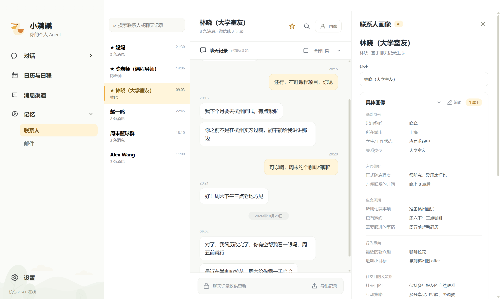
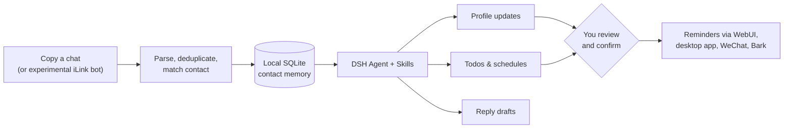
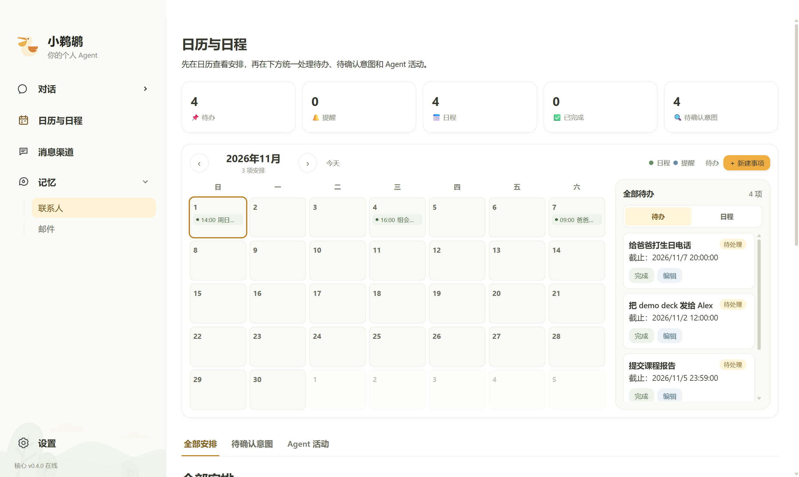
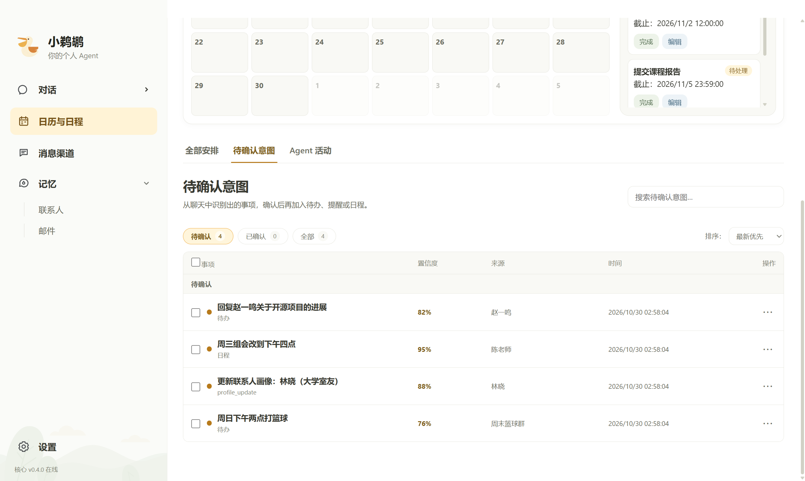

<p align="center">
  
</p>

<h1 align="center">TinyPelican · 小鹈鹕</h1>

<p align="center">
  <b>Copy a chat. Get a relationship memory.</b><br>
  A local-first AI social copilot that turns copied WeChat chats into contact profiles, todos, schedules and reply drafts.
</p>

<p align="center">
  <a href="https://github.com/Oii6111/TinyPelican/stargazers"></a>
  <a href="https://github.com/Oii6111/TinyPelican/blob/main/LICENSE"></a>
  <a href="https://github.com/Oii6111/TinyPelican/commits/main"></a>
  
  = 22.13">
</p>

<p align="center">🌐 <b>English</b> · <a href="README.zh-CN.md">中文</a></p>

<p align="center">
  
</p>

<p align="center"><sub>Screenshots use fictional demo data. The UI is currently in Chinese.</sub></p>

---

## Why TinyPelican

You promise a friend you'll review their résumé by Friday. Your professor moves a meeting. Your mom reminds you about your dad's birthday. All of it lives in chat, and most of it gets forgotten.

Personal CRMs like [Monica](https://github.com/monicahq/monica) can track this, but only if you type everything in by hand. TinyPelican skips the data entry. You copy a chat as you normally would; TinyPelican detects it on the clipboard, files it under the right contact, and an AI agent extracts what matters:

- **Who this person is**: nickname, city, current situation, interests, boundaries, and your own goal for the relationship.
- **What you owe each other**: todos with deadlines, schedules, and messages still waiting for your reply.
- **What to say next**: reply drafts that fit the relationship. They are filled in for you to edit and are never sent automatically.

Everything runs on your machine with your own model API key.

## How it works



The AI proposes; you decide. Extracted todos, schedules and profile changes land in a review queue with a confidence score and the original message as evidence. Nothing becomes a task or a profile fact until you confirm it.

## Screenshots

<table>
  <tr>
    <td width="50%"></td>
    <td width="50%"></td>
  </tr>
  <tr>
    <td align="center"><b>Calendar and schedules.</b> Events and deadlines pulled from chats, next to your open todos.</td>
    <td align="center"><b>Review queue.</b> Every extracted item shows its confidence and source before you accept it.</td>
  </tr>
</table>

## Features

| Capability | Description | Status |
|---|---|---|
| Chat ingestion | Clipboard auto-detection of WeChat chats, ZIP/TXT archive import, experimental iLink bot channel | ✅ Live |
| Contact profiles | One profile per contact, continuously extracted from conversations, with topic summaries | ✅ Live |
| Relationship reasoning | Importance, recent context, preferences, boundaries, social goals | ✅ Basic |
| Intent extraction | Tasks, deadlines, schedules, waiting-for-reply, with human review | ✅ Basic |
| Proactive reminders | Deadline reminders, do-not-disturb hours, nudges for neglected relationships | ✅ Basic |
| Reply drafts | Relationship-aware suggestions, one-click fill, never auto-sent | ✅ Live |
| Agent execution | DSH Agent with structured Skills and an auditable event stream | ✅ Live |
| Email | IMAP sync, classification and summaries, SMTP sending, contact email links | ✅ Basic |
| WeChat media | Image and file transfer with previews | ✅ Live |
| Spoken diary via bot | Tell the WeChat bot about your day; the Agent files it into memory | 🚧 In progress |
| More channels | QQ, Feishu / DingTalk, Telegram | ⏳ In development |
| Wearable activity import | AI glasses, cameras and watches as memory inputs | ⏳ Planned |

## How it compares

| | TinyPelican | Monica | General AI assistant |
|---|---|---|---|
| Data entry | Automatic from copied chats | Manual | None |
| Relationship profiles | AI-extracted, continuously updated | Manual forms | No persistent memory |
| Proactive reminders | From chat commitments and relationship signals | User-set only | No |
| Reply drafts | Relationship-aware | No | Generic |
| Where data lives | Your machine, your model key | Self-host option | Vendor cloud |

## What TinyPelican is not

- It does **not** read WeChat silently in the background. Chats come in only when you copy them, import an export file, or use the experimental iLink bot channel.
- It is **not** an official WeChat integration and does not promise real-time sync for every scenario.
- It **never** sends a message on your behalf without you pressing send.

## Quick start

**Requirements:** Windows, Node.js **22.13+** (Node 24 LTS recommended, since `node:sqlite` needs an unflagged runtime), and one OpenAI-compatible model provider (DeepSeek, OpenAI, SiliconFlow, Ollama or a custom endpoint). The DSH Agent WebUI is bundled and runs on `http://127.0.0.1:18792`.

```powershell
git clone https://github.com/Oii6111/TinyPelican.git
cd TinyPelican
npm install
npm run daemon
```

Open `http://127.0.0.1:18791`, then go to **Settings → Model service** and enter your API key and model name.

Desktop app (Electron):

```powershell
cd app
npm install
npm start
```

Closing the window hides TinyPelican to the system tray and keeps it running. Double-click the tray icon to reopen it, or choose "Stop app" from the tray menu to quit and stop the core service.

Other commands:

```powershell
npm run server      # WebUI/API only
npm test            # tests
npm run check       # syntax checks
npm run remind:dry  # preview reminder rules
```

Setting up on a new machine or building the installer: see the [deployment guide](docs/deployment.md) and [Windows installer notes](docs/windows-installer.md) (Chinese).

## Repository map

```text
app/          Electron desktop shell
agent/        Agent.md, Skills, DSH event stream
core/         APIs, Agent, SQLite memory, ingestion, reminders, channels
dashboard/    Native ES Module WebUI
docs/         Guides and design notes
tests/        Unit and integration tests
```

Runtime data (SQLite databases, tasks, schedules, intents, credentials, logs and chat records) is gitignored and never leaves your machine.

## Documentation

- [Contact workspace guide](docs/contacts-ui.md)
- [Chat import](docs/chat-import.md)
- [Topics and memory](docs/topics-and-memory.md)
- [DSH conversation page](docs/dsh-webui.md)
- [WeChat media](docs/weixin-media.md)
- [Recent changes](docs/recent-changes.md)

The docs are currently in Chinese.

## Roadmap

1. Make contact memory, proactive reminders and reply drafts a daily habit.
2. Improve intent accuracy with human-in-the-loop feedback.
3. Group-chat model and wearable activity import adapters.
4. More channel adapters: QQ, Feishu / DingTalk, Telegram, calendar.

## Contributing

TinyPelican is maintained by an undergraduate student, so multi-channel support takes time and help is very welcome. Every channel follows a small `connect / stop / send` contract, which makes adapters a good first contribution. Agent Skills and the relationship-reasoning core are open too.

See [CONTRIBUTING.md](CONTRIBUTING.md). Issues labeled `good first issue` are a good place to start.

## Star history

<a href="https://star-history.com/#Oii6111/TinyPelican&Date">
  
</a>

If TinyPelican is useful or interesting to you, a ⭐ helps more people find it.

## License

[MIT](LICENSE)
