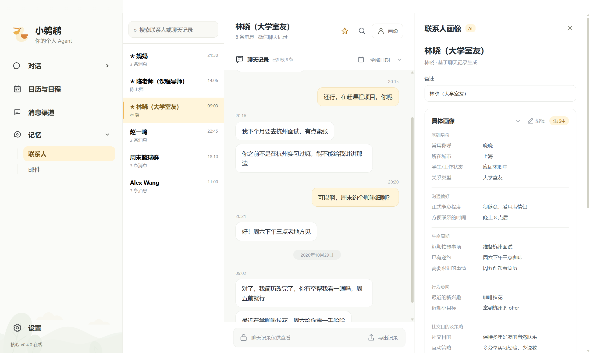
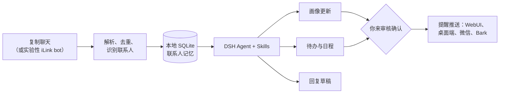
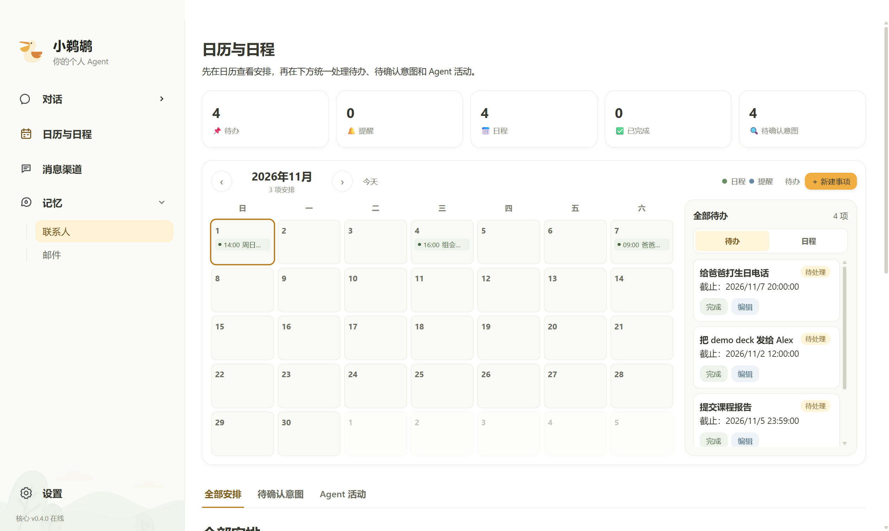
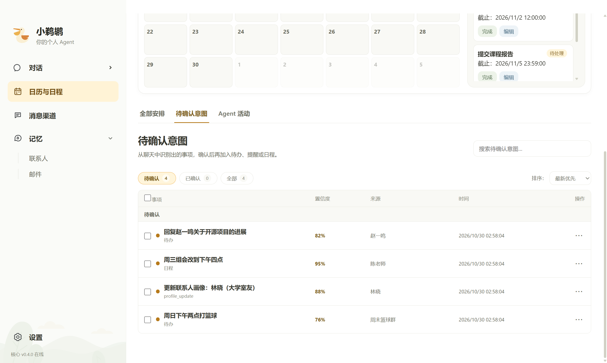

<p align="center">
  
</p>

<h1 align="center">小鹈鹕 TinyPelican</h1>

<p align="center">
  <b>复制一段聊天，得到一份关系记忆。</b><br>
  本地优先的 AI 社交副驾驶：把复制的微信聊天变成联系人画像、待办、日程和回复草稿。
</p>

<p align="center">
  <a href="https://github.com/Oii6111/TinyPelican/stargazers"></a>
  <a href="https://github.com/Oii6111/TinyPelican/blob/main/LICENSE"></a>
  <a href="https://github.com/Oii6111/TinyPelican/commits/main"></a>
  
  = 22.13">
</p>

<p align="center">🌐 <a href="README.md">English</a> · <b>中文</b></p>

<p align="center">
  
</p>

<p align="center"><sub>截图均为虚构的演示数据。</sub></p>

---

## 为什么做小鹈鹕

你答应朋友周五前帮他看简历，老师把组会改了时间，妈妈提醒你下周是爸爸生日。这些事都在聊天里，大多数最后都忘了。

[Monica](https://github.com/monicahq/monica) 这类个人 CRM 能记这些，前提是你一条条手动录入。小鹈鹕省掉了录入：你像平时一样复制聊天，它从剪贴板识别出来，归档到对应联系人，再由 AI Agent 提取有用的信息：

- **这个人是谁**：称呼、城市、近况、兴趣、边界，以及你自己对这段关系的目标。
- **彼此答应了什么**：带截止时间的待办、日程，还有等你回复的消息。
- **接下来怎么回**：符合关系分寸的回复草稿，一键回填后由你修改，永远不会自动发送。

所有数据都在你自己的电脑上，模型用你自己的 API Key。

## 工作流程



AI 只提建议，决定权在你。提取出的待办、日程和画像变更会先进入「待确认」列表，附带置信度和原始消息作为依据。你确认之后，它们才会变成正式任务或画像内容。

## 产品截图

<table>
  <tr>
    <td width="50%"></td>
    <td width="50%"></td>
  </tr>
  <tr>
    <td align="center"><b>日历与日程。</b>从聊天中提取的安排和截止时间，旁边是未完成的待办。</td>
    <td align="center"><b>待确认意图。</b>每一条都显示置信度和来源，确认后才生效。</td>
  </tr>
</table>

## 功能

| 能力 | 说明 | 状态 |
|---|---|---|
| 聊天接入 | 剪贴板自动识别微信聊天、ZIP/TXT 导出文件导入、实验性 iLink bot 通道 | ✅ 已落地 |
| 联系人档案 | 一人一档，从对话中持续抽取，附话题总结 | ✅ 已落地 |
| 关系推演 | 重要程度、近况、偏好、边界、社交目标 | ✅ 基础版 |
| 意图抽取 | 任务、DDL、日程、等待回复，人工审核后生效 | ✅ 基础版 |
| 主动提醒 | 到期提醒、免打扰时段、冷落关系提醒 | ✅ 基础版 |
| 回复草稿 | 懂分寸的关系化建议，一键回填，永不自动发送 | ✅ 已落地 |
| Agent 执行 | DSH Agent + 结构化 Skills，过程可审计 | ✅ 已落地 |
| 邮件 | IMAP 同步、分类与摘要、SMTP 发送、联系人邮箱关联 | ✅ 基础版 |
| 微信媒体 | 图片和文件收发、附件预览 | ✅ 已落地 |
| 语音日记（bot） | 对微信 bot 说说今天的事，Agent 沉淀到记忆 | 🚧 进行中 |
| 更多社交通道 | QQ、飞书 / 钉钉、Telegram | ⏳ 开发中 |
| 穿戴设备活动导入 | AI 眼镜 / 相机 / 手表作为记忆输入 | ⏳ 规划 |

## 和其他方案的区别

| | 小鹈鹕 | Monica | 通用 AI 助手 |
|---|---|---|---|
| 数据录入 | 从复制的聊天自动获取 | 手动 | 无 |
| 关系档案 | AI 抽取、持续更新 | 手动表单 | 无持久记忆 |
| 主动提醒 | 从聊天承诺与关系信号生成 | 仅用户手动设置 | 无 |
| 回复草稿 | 懂关系分寸 | 无 | 通用 |
| 数据位置 | 你的电脑，你的模型 Key | 可自托管 | 厂商云端 |

## 小鹈鹕不做什么

- **不会**在后台偷偷读取微信。只有你复制聊天、导入导出文件或使用实验性 iLink bot 通道时，聊天才会进来。
- **不是**官方微信集成，也不承诺全场景实时同步。
- 不经你点击发送，**绝不会**替你发出任何消息。

## 快速开始

**环境要求：** Windows、Node.js **22.13+**（推荐 Node 24 LTS，`node:sqlite` 需要无需实验开关的版本）、至少一个 OpenAI 兼容模型服务（DeepSeek、OpenAI、硅基流动、Ollama 或自定义地址）。DSH Agent WebUI 已内置，默认运行在 `http://127.0.0.1:18792`。

```powershell
git clone https://github.com/Oii6111/TinyPelican.git
cd TinyPelican
npm install
npm run daemon
```

打开 `http://127.0.0.1:18791`，在「设置 → 模型服务」填写 API Key 和模型名。

桌面端（Electron）：

```powershell
cd app
npm install
npm start
```

关闭桌面窗口后，小鹈鹕会隐藏到系统托盘并继续在后台运行。双击托盘图标，或右键选择「打开小鹈鹕」可恢复窗口；右键选择「停止应用」会退出应用并停止后台核心服务。

其他命令：

```powershell
npm run server      # 仅启动 WebUI/API
npm test            # 测试
npm run check       # 全量语法检查
npm run remind:dry  # 预览提醒规则
```

新电脑部署和打包安装程序，见[部署说明](docs/deployment.md)和 [Windows 安装程序说明](docs/windows-installer.md)。

## 目录结构

```text
app/          Electron 桌面端
agent/        Agent.md、Skills、DSH 事件流
core/         API、Agent、SQLite 记忆、导入、提醒、通道
dashboard/    原生 ES Module WebUI
docs/         使用说明与设计文档
tests/        单元测试和集成测试
```

运行数据（SQLite 数据库、任务、日程、意图、凭据、日志、聊天记录）均已加入 Git 忽略，不会离开你的电脑。

## 文档

- [联系人界面使用与开发说明](docs/contacts-ui.md)
- [聊天记录导入](docs/chat-import.md)
- [话题与记忆](docs/topics-and-memory.md)
- [对话页面说明](docs/dsh-webui.md)
- [微信媒体说明](docs/weixin-media.md)
- [近期功能更新](docs/recent-changes.md)

## 路线图

1. 让联系人记忆、主动提醒、回复草稿成为日常习惯。
2. 通过人在回路反馈提升意图识别准确率。
3. 群聊模型与穿戴设备活动导入适配器。
4. 更多通道适配器：QQ、飞书 / 钉钉、Telegram、日历。

## 参与贡献

小鹈鹕由一名本科生维护，多通道支持需要时间，非常欢迎帮忙。每个通道都遵循简单的 `connect / stop / send` 契约，写一个通道适配器很适合作为第一次贡献。Agent Skills 和关系推演内核也欢迎参与。

详见 [CONTRIBUTING.md](CONTRIBUTING.md)。可以从带 `good first issue` 标签的 issue 开始。

## Star 趋势

<a href="https://star-history.com/#Oii6111/TinyPelican&Date">
  
</a>

如果小鹈鹕对你有用或有启发，点个 ⭐ 能让更多人看到它。

## License

[MIT](LICENSE)
